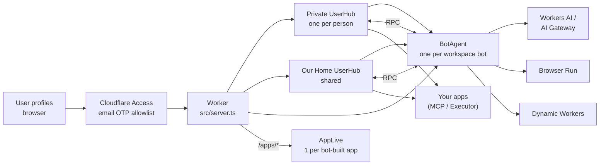
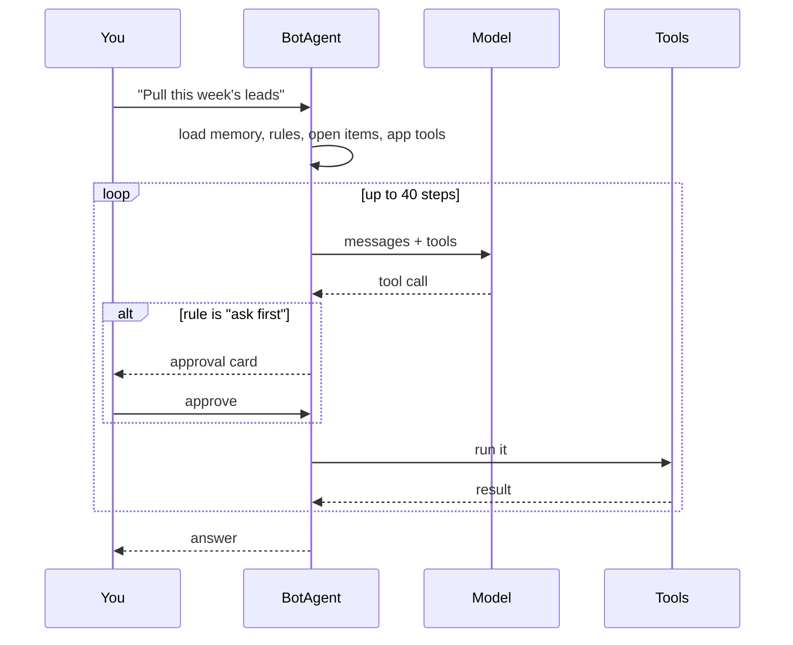
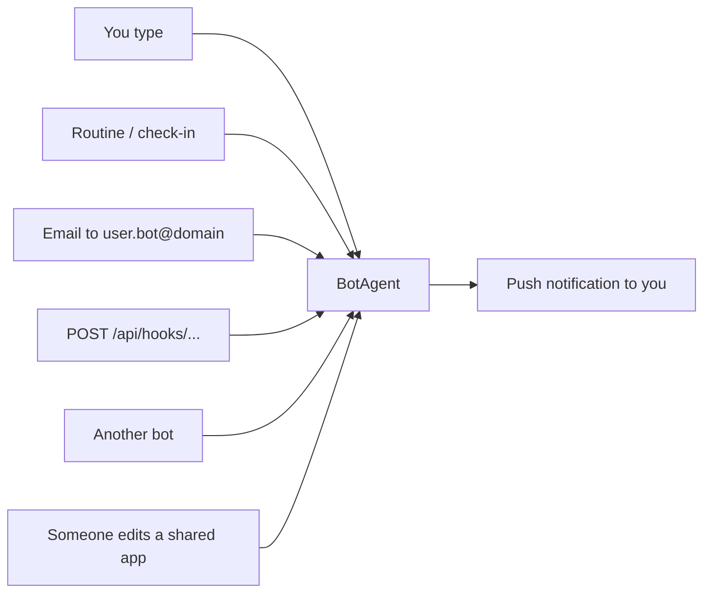

# 🤖 Coworkers

AI teammates that each get their own computer and browser. Built entirely on
Cloudflare.

You create bots, give each one a job, and they work for you, even when
you're away. They ask before doing anything risky. When one needs a login,
it hands you its browser.

> [!WARNING]
> Coworkers is still under heavy development and is experimental. Use it with
> caution.

> [!NOTE]
> `@cloudflare/think`, `@cloudflare/computer`, the `cf` CLI and the
> Cloudflare Vite plugin 2.0 are preview or beta. Expect breaking changes.

## The big picture

One Worker runs everything. There are three kinds of Durable Objects:



| Durable Object | What it owns                                                        |
| -------------- | ------------------------------------------------------------------- |
| `UserHub`      | A person's private bot list or the shared household bot list, connections, memory, and push subscriptions |
| `BotAgent`     | One bot in one workspace: chat, memory, rules, routines, files, browser, secrets      |
| `AppLive`      | Live updates for a web app a bot built                              |

- Each bot keeps everything in its own SQLite. There's no separate database.
- You sign in to an app once, on the hub. Every bot uses that connection.
- The Worker checks the Access identity against the workspace before routing
  snapshots or agent WebSockets. Each person has a private workspace; members
  on the setup email allowlist can also use **Our Home**.
- Bot-built app links require both Cloudflare Access and their app link token.
  Only inbound webhooks have an Access bypass, and each webhook still requires
  its per-bot capability token.

## What a bot can do

| Feature        | How it works                                                                 |
| -------------- | ---------------------------------------------------------------------------- |
| Chat           | Streaming, resumable turns. Names itself from your first task                |
| Computer       | Files in `/workspace` + a shell (`curl`, `jq`) in a Dynamic Worker. No container |
| Read the web   | Quick reads (markdown, extract, links, screenshot, PDF, crawl). Kitesurf first, Chromium fallback |
| Drive a browser| A real Chromium session you can watch live                                  |
| Take over      | Bot hands you its browser to sign in. You click **I'm done**, it continues   |
| Your apps      | Calls tools on connected MCP servers or Executor                             |
| Rules          | Per action type: allow, ask first, or block                                  |
| Routines       | Cron, one-off, or webhook-triggered jobs. Test a routine before relying on it |
| Check-ins      | Wakes every few hours, speaks only if something's worth saying             |
| Memory         | Its own memory + one shared across all your bots. Both have version history  |
| Open items     | Tracks things it's waiting on until they're resolved                         |
| Group chats    | Bring several bots into one visible conversation; mention a bot to direct a turn |
| Needs me       | One inbox for approvals, background-task results, overdue follow-ups, and routine failures |
| Project files  | Explicitly share bounded-size files across bots in the current workspace     |
| Other bots     | Direct messages and files to other bots                                       |
| Web apps       | Builds small sites (trackers, dashboards) on its own data, shareable by link |
| Teach by demo  | Records you doing a task in its browser, saves it as a skill                 |
| Secrets        | You type an API key in a masked card. The bot uses it but never sees it      |
| Wake-ups       | Inbound email, webhooks, and push notifications to you                       |

## How a turn works



- A loop guard stops the bot from repeating the same call over and over.
- Unanswered approvals get a push reminder after 4 hours and close after 24.
- Background turns (routines, check-ins, email, webhooks) can use a cheaper
  model via `BACKGROUND_MODEL`.

## Rules

Each bot has one setting per action type:

| Action type       | Default   |
| ----------------- | --------- |
| Edit files        | allow     |
| Run commands      | allow     |
| Read the web      | allow     |
| Drive the browser | allow     |
| Use connected apps| ask first |
| Message other bots| allow     |
| Schedule routines | allow     |

Nobody is around to approve a background turn. So by default it can only use
app tools that are read-only.

## Ways to wake a bot



## Stack

| Layer      | What we use                                                   |
| ---------- | ------------------------------------------------------------- |
| Runtime    | Cloudflare Workers, Durable Objects (SQLite)                  |
| Agents     | `agents` SDK, `@cloudflare/think`, `@cloudflare/computer`     |
| Models     | Workers AI, or any provider through AI Gateway                |
| Browser    | Browser Run: Chromium, Live View, Kitesurf                    |
| Sandboxing | Dynamic Workers (shell, bot-built app servers)                |
| Inbound    | Email Routing, webhooks, Web Push                             |
| Frontend   | TanStack Start, React 19, Tailwind v4, Kumo, Hugeicons        |
| Tooling    | `cf` CLI, Vite, Vitest, pnpm                                  |

## Run it locally

```bash
npm i -g cf
```

```bash
pnpm install
```

```bash
cf auth login
```

```bash
pnpm dev
```

Then open http://localhost:3000.

- **Why Cloudflare login?** Workers AI and Browser Run can't run locally, so dev
  calls your real account for those two. Everything else runs on disk under
  `.cloudflare/state/`.
- **More than one account?** Prefix with `CLOUDFLARE_ACCOUNT_ID=<id>`.
- **Secrets:** copy `.dev.vars.example` to `.dev.vars`. All of them are
  optional.

## Deploy

You need a Cloudflare account on the **Workers Paid** plan (Browser Run and
Dynamic Workers require it).

### Option A: the installer

Sign in with Cloudflare, pick a name, who can sign in and a model, and the
installer builds Coworkers into your account: the Worker, an AI Gateway, and
Cloudflare Access in front. Re-running it with the same name updates Coworkers
and keeps your bots. How it works and how to host it: [`installer/`](installer/README.md).

### Option B: one command

```bash
export DO_NOT_TRACK=1
git clone 'https://github.com/your-account/coworkers.git' && cd coworkers
git remote add upstream https://github.com/fayazara/coworkers.git
pnpm install
cf auth login
pnpm run setup
```

To deploy from GitHub Actions, configure these repository secrets, then run
**Deploy Worker** on `main`: `CLOUDFLARE_API_TOKEN`, `CLOUDFLARE_ACCOUNT_ID`,
`COWORKERS_DEPLOY_CONFIG_JSON` (the private deployment JSON), and
`COWORKERS_WORKER_SECRETS` (the contents of the private Worker secrets file).
The workflow writes the private files with owner-only permissions and never
checks them into Git.

`scripts/setup.ts` asks for the account, a name, who can sign in and a model,
then does what the installer does with the `cf` CLI:

1. creates the AI Gateway and Web Push keys
2. deploys once with Access required but not yet set up, so the new URL
   refuses every request instead of being open
3. sets up Cloudflare Access: an email OTP allow list and a path-scoped,
   token-authenticated webhook bypass (no WARP enrollment is required)
4. deploys again with the Access application's AUD

Your choices go in `coworkers.deploy.json` and secrets in `.dev.vars.production`.
Both are git-ignored. **To update later:** `git pull`, then `pnpm run setup`
again. It remembers your answers, and bots and their data are kept.

Use `pnpm run setup`, not `pnpm setup` (a pnpm built-in). Add `-- --yes` to
skip the questions and reuse your saved answers, e.g. in CI.

<details>
<summary><strong>Option C: every step by hand</strong></summary>

The same result with the dashboard and `cf`, if you want to see each piece.
With more than one account, prefix `cf` commands with
`CLOUDFLARE_ACCOUNT_ID=<id>`.

**1. Create the AI Gateway**

```bash
cf ai-gateway gateways create --body '{
  "id": "coworkers",
  "authentication": true,
  "collect_logs": false,
  "cache_invalidate_on_update": true,
  "cache_ttl": 0,
  "rate_limiting_interval": 0,
  "rate_limiting_limit": 0
}'
```

**2. Write `coworkers.deploy.json`** in the repo root. Leaving out the Access
values deploys Coworkers open to everyone as the `demo` user, so start with
placeholders that lock it:

```json
{
  "name": "coworkers",
  "gateway": "coworkers",
  "workersDev": true,
  "accessTeamDomain": "locked.invalid",
  "accessAud": "locked"
}
```

**3. Secrets and the first deploy**

```bash
npx web-push generate-vapid-keys
cp .dev.vars.example .dev.vars.production   # paste both keys in
pnpm run deploy --secrets-file .dev.vars.production
```

Note the `https://<name>.<subdomain>.workers.dev` URL it prints. It answers
401 for now.

**4. Cloudflare Access.** In [Zero Trust](https://one.dash.cloudflare.com/)
(the free plan is enough):

1. Create an **Allow** policy with the exact email addresses that may sign in.
   Cloudflare Access sends each person a one-time PIN by email.
2. Create a self-hosted application for your Coworkers hostname and apply the
   Allow policy. Use the public hostname, not a Worker destination: Worker
   destinations refuse WebSocket upgrades.
3. Create a separate self-hosted application for the path `api/hooks/*` and
   apply a **Bypass** policy for Everyone. Each webhook still requires its
   per-bot capability token. Do not bypass `/apps/*`; app links require Access
   as well as their link token.
4. Copy the main application's **Application Audience (AUD) Tag** from its
   overview. Your team domain is on Zero Trust's **Settings** page.

**5. Unlock and deploy again.** Put the real values in `coworkers.deploy.json`:

```json
  "accessTeamDomain": "<team>.cloudflareaccess.com",
  "accessAud": "<aud tag>"
```

```bash
pnpm run deploy --secrets-file .dev.vars.production
```

</details>

Either way, Coworkers then checks the Access token on every protected request
and answers 401 without a valid one, so it stays closed even if Access is
turned off by mistake. Each email gets its own private workspace. Emails on
the setup allowlist can also access the shared **Our Home** workspace.

### After deploying: models

Open **Models** (the brain icon at the bottom of the sidebar). Workers AI
models need nothing more. For Anthropic, OpenAI, Google or xAI, add
[Unified Billing](https://developers.cloudflare.com/ai-gateway/features/unified-billing/)
credits or your own provider key to the gateway, then press **Test**.

## Configuration

Set in `cloudflare.config.ts`. Everything has a working default.
`coworkers.deploy.json`, if present, overrides the name, `MODEL`,
`AI_GATEWAY_ID` and the two `ACCESS_*` values.

| Setting                  | What it does                                                          |
| ------------------------ | --------------------------------------------------------------------- |
| `MODEL`                  | Default chat model. `@cf/...` = Workers AI, `provider/model` = catalog |
| `BACKGROUND_MODEL`       | Model for routines, check-ins and email. Empty = the chat model        |
| `FALLBACK_MODEL`         | Workers AI model a turn retries on when a third-party model fails      |
| `AI_GATEWAY_ID`          | Gateway for every model call. Prompt/response log collection is disabled |
| `ACCESS_TEAM_DOMAIN`     | With `ACCESS_AUD`, require a valid Access token on every request       |
| `ACCESS_AUD`             | The Access application's AUD tag                                       |
| `HOUSEHOLD_WORKSPACE_ID` | Stable Durable Object name for the shared household workspace         |
| `HOUSEHOLD_MEMBERS`      | Email allowlist that can open the shared household workspace          |
| `QUICK_ACTION_ENGINE`    | `kitesurf` (cheaper) or `chromium` for quick page reads                |
| `EMAIL_DOMAIN`           | Turns on inbound email. Each bot gets `<user>.<bot>@<domain>`         |
| `BROWSER_RUN_ACCOUNT_ID` | With `BROWSER_RUN_API_TOKEN` (secret), turns on the crawl tool        |
| `VAPID_*`                | Push notification keys (`npx web-push generate-vapid-keys`)           |

The Models page overrides `MODEL` and `BACKGROUND_MODEL` for your account,
and each bot can pick its own chat model in its settings.

The app does not load web analytics or tracking beacons. Worker invocation
logs and AI Gateway prompt/response logging are disabled by default.

## Project layout

```
src/
  server.ts           Worker entry: auth, /agents/*, /apps/*, inbound email
  agents/
    user-hub.ts       one per user: bot list, connections, shared memory, push
    bot-agent.ts      one per bot: tools, rules, routines, computer, browser
    prompt.ts         the bot's system prompt
    web-tools.ts      quick web read tools
    apps-runtime.ts   serves bot-built apps + AppLive
    app-store.ts      app data and share links
    teach.ts          records a demo in the browser
    secrets.ts        credentials the bot never sees
    guards.ts         stops runaway loops
    memory.ts         memory helpers
    models.ts         model factory: AI Gateway, fallback, log metadata
  routes/
    _app/             bot thread, computer + settings panels, connections, models
    api/hooks.*.ts    webhook endpoint
  components/         thread, Computer card, sidebar, panels
  lib/                shared types, server functions, React contexts
installer/            "Deploy to Cloudflare" wizard (its own Worker)
scripts/setup.ts      the same deploy, from your terminal with cf
cloudflare.config.ts  Worker config and bindings
AGENTS.md             read this first if you're an AI coding agent
```

## Scripts

| Command           | What it does                            |
| ----------------- | --------------------------------------- |
| `pnpm dev`        | Dev server on :3000, running on workerd |
| `pnpm build`      | Production build                        |
| `pnpm run setup`  | Deploy with AI Gateway + Access (asks)  |
| `pnpm run deploy` | Build and deploy                        |
| `pnpm test`       | Vitest                                  |
| `pnpm typecheck`  | Regenerate binding types, then `tsc`    |
| `pnpm format`     | Prettier                                |
